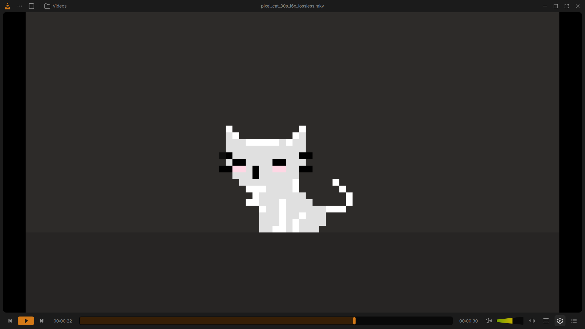

# VLC Reimagined

*A fresh visual experience for VLC, inspired by a design concept and built for the community.*

VLC Reimagined is a personal, open-source project exploring a modern native
interface on top of VLC's existing media engine. It brings together
[Juxtopposed's design concept](https://www.youtube.com/watch?v=ERFeOgqk324),
[David Sojevic's native implementation](https://github.com/dsojevic/juxtopposed-vlc),
and this fork's integration fixes, Windows packaging, and validation.

**This is an unofficial community fork, not an official VideoLAN project or
release. It is not affiliated with or endorsed by VideoLAN or Juxtopposed.**



*Real application screenshot inherited from David Sojevic's implementation;
not a fresh capture of this fork's Windows preview or proof of complete design parity.*

## Download and try it

**[Download the Windows x64 portable preview (ZIP, about 100 MB)](https://github.com/Uvaisbugh/vlc/releases/download/redesign-preview-2026.10.20/vlc-redesign-windows-x64-preview.zip)**

[Release notes, matching source, and checksums](https://github.com/Uvaisbugh/vlc/releases/tag/redesign-preview-2026.10.20)
· [Installation and troubleshooting](doc/reimagined/GETTING_STARTED.md)

1. Download the ZIP and use **Extract All** into a writable folder.
2. Open the extracted **VLC Redesign** folder, then double-click **vlc.exe**.
3. Open a local audio or video file using the app's menu. No installer, build tools,
   or administrator access is required. Keep the DLLs, plugins, and `portable`
   folder together.

The published package still uses the name **VLC Redesign**. Its portable profile
keeps settings separate from installed VLC. This is an **unsigned preview**.
Windows x64 is the only distributed platform verified for this release; CI ran
on Windows Server 2022, with additional local Windows testing recorded without
an exact OS version. A consumer Windows version compatibility matrix is still
needed. No verified Linux, macOS, Windows ARM64, or 32-bit download is offered here.

For updates, use this repository's release page manually. The inherited in-app
updater still targets the earlier community fork.

## What is here today?

| Area | Current evidence |
| --- | --- |
| Native player and controls | Qt 6/QML UI connected to VLC's C/C++ backend; Windows startup, audio decoding, video decoding, and Qt video output passed |
| Seeking, subtitles, queue, fullscreen | Prior local checks recorded play/pause, pointer seeking, seek preview, subtitle rendering, queue display, and fullscreen/restore |
| Library and settings | Source implementations and focused Qt tests exist; settings opening/closing was checked locally; comprehensive library and settings behavior remains under audit |
| Automated tests | 82 native Qt suites passed on Linux in the recorded validation run; this is not a guarantee for every codec, device, or interaction |
| Design fidelity and accessibility | Full frame/state parity, high-DPI behavior, keyboard-only use, and assistive-technology coverage are unfinished audits |

See [status and evidence](doc/reimagined/STATUS.md) for exact commits, CI jobs,
limitations, and screenshot provenance. See the [roadmap](ROADMAP.md) for ways to help.

## Build from source

The redesign is integrated into the repository's default `master` branch:

```sh
git clone --branch master https://github.com/Uvaisbugh/vlc.git vlc-reimagined
cd vlc-reimagined
```

Start with the [development guide](doc/reimagined/DEVELOPMENT.md) for the pinned
Windows cross-build environment, Linux native Qt build/test workflow, and
debugging. The code uses Qt 6, QML, C++, VLC's C core, Meson/Ninja and
Autotools/Make. Python and shell scripts handle packaging and validation.
The wider VLC tree also contains Objective-C, assembly, Rust, and Lua.

Existing platform instructions remain available for
[Windows](doc/BUILD-win32.md), [Linux](doc/BUILD-linux.md), and
[macOS](doc/BUILD-macos.md). The Linux/macOS desktop guides include inherited
community results and configurations that disable the media library; they do
not establish supported releases of this fork.

## Contribute

Bug reports, usability feedback, documentation, translations, accessibility
testing, and code contributions are welcome. You do not need to build VLC to help.

- [Report a bug or suggest an improvement](https://github.com/Uvaisbugh/vlc/issues/new/choose).
- Read [CONTRIBUTING.md](CONTRIBUTING.md) for small first tasks and PR expectations.
- Pick a bounded task from the [community roadmap](ROADMAP.md).
- Use [VideoLAN's upstream repository](https://code.videolan.org/videolan/vlc/)
  for changes intended for official VLC.

## Inspiration, credits, and licenses

- **Design:** [VLC Redesign by Juxtopposed](https://www.figma.com/community/file/1691465999134370980/vlc-redesign),
  inspired by the [original video](https://www.youtube.com/watch?v=ERFeOgqk324).
  The repository records the design under [CC BY 4.0](https://creativecommons.org/licenses/by/4.0/).
  The native interface adapts its layouts and interactions. See [asset credits](modules/gui/qt/pixmaps/redesign/CREDITS.md).
- **Engine and upstream application:** VideoLAN and the VLC contributors;
  [AUTHORS](AUTHORS), [THANKS](THANKS), [official VLC](https://www.videolan.org/vlc/),
  and [upstream source](https://code.videolan.org/videolan/vlc/).
- **Integrated native redesign:** [David Sojevic and contributors](https://github.com/dsojevic/juxtopposed-vlc),
  with history and notices preserved. [Integration record](doc/redesign/INTEGRATION.md).
- **This fork:** Uvais Bughari's integration, targeted fixes, build/test work, and
  Windows preview packaging; the design and full implementation are not claimed as original work.
- **Software:** VLC is GPL-2.0-or-later ([COPYING](COPYING)); libVLC uses
  LGPL-2.1-or-later ([COPYING.LIB](COPYING.LIB), [source notice](lib/core.c)).
  Some dependency combinations impose GPLv3 requirements; retain individual notices.
- **Typography:** Inter by Rasmus Andersson and contributors,
  [SIL Open Font License 1.1](modules/gui/qt/fonts/LICENSE.txt).

VLC and VideoLAN names and marks belong to VideoLAN. The community project name
does not imply endorsement or trademark permission. Existing license and
copyright notices remain intact. [Upstream background and retained README material](doc/UPSTREAM.md).
